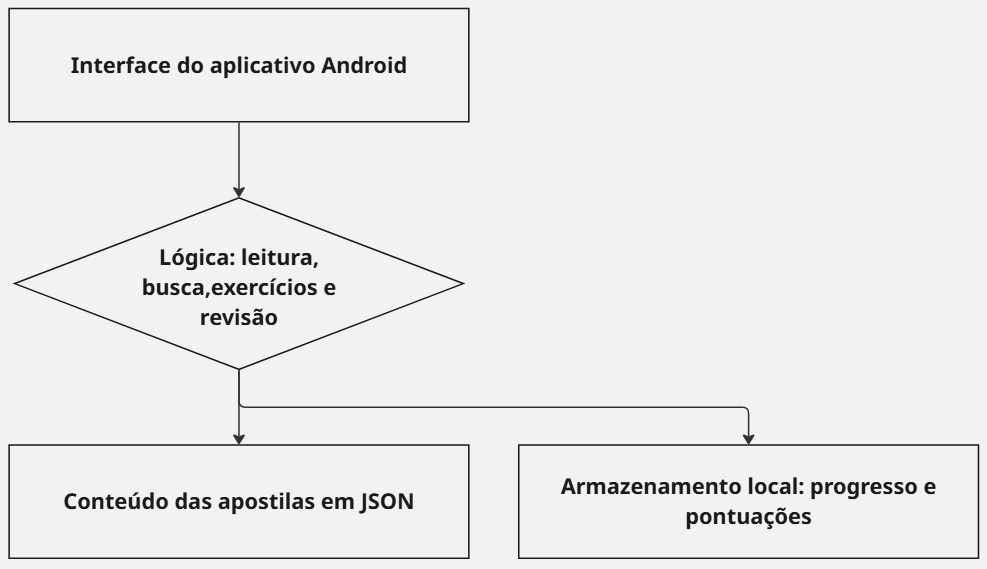

# Arquitetura proposta — Abrindo Portas

**Status:** projeto técnico proposto; implementação pendente.

## Visão geral

O aplicativo será desenvolvido inicialmente para Android, com processamento local e prioridade para leitura e prática offline.

A arquitetura separa a interface, a lógica das funcionalidades e o acesso aos dados.

## Responsabilidades

| Parte | Responsabilidades |
|---|---|
| Interface | Apresentar módulos, capítulos, lições, busca, exercícios, resultados e progresso. |
| Consulta de conteúdo e busca | Ler o conteúdo estruturado e localizar vocabulários, traduções e regras gramaticais. |
| Exercícios e revisão | Apresentar atividades, validar respostas, fornecer feedback e organizar quizzes por capítulo. |
| Progresso e desempenho | Controlar o estado das lições e calcular indicadores de conclusão e acertos. |
| Conteúdo em JSON | Organizar módulos, capítulos, lições, exercícios, alternativas e gabaritos. |
| Persistência local | Salvar e recuperar progresso e tentativas no dispositivo. |

## Fluxo principal

1. O aluno seleciona um módulo, capítulo e lição.
2. O aplicativo consulta o conteúdo em JSON e apresenta a lição.
3. O aluno acessa os exercícios e envia uma resposta.
4. A lógica local compara a resposta com o gabarito.
5. O aplicativo apresenta o feedback e registra a tentativa.
6. Os registros são utilizados para apresentar o progresso e o desempenho.

## Decisões previstas

- As funções principais não dependerão de uma API externa.
- O conteúdo incluído no dispositivo estará disponível para leitura e prática offline.
- A busca e a correção dos exercícios serão executadas localmente.
- As alternativas poderão ser embaralhadas sem alterar seus gabaritos.
- Uma fonte remota para distribuição de conteúdo poderá ser considerada posteriormente, sem impedir o uso do conteúdo já disponível offline.

## Definições pendentes

- Framework de desenvolvimento.
- Tecnologia de persistência local.
- Formato detalhado do conteúdo JSON.
- Regras de conclusão das lições e cálculo dos indicadores.
- Estratégia de atualização do material didático.

## Limites

Esta arquitetura descreve a solução planejada. O protótipo visual não comprova a implementação do armazenamento, da busca, da validação ou do funcionamento offline.