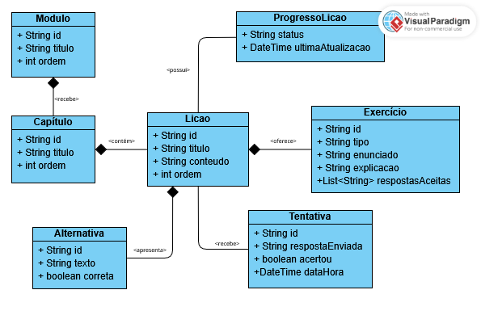

# Diagrama de classes proposto — Abrindo Portas

**Status:** modelagem proposta; implementação pendente.

## Objetivo

Representar a organização do conteúdo didático e os registros locais de estudo do aluno.

O modelo é independente do framework escolhido e não significa que todas as classes serão convertidas em tabelas de banco de dados.

## Diagrama

## Responsabilidades das classes

| Classe | Responsabilidade |
|---|---|
| Modulo | Agrupar capítulos e definir sua posição na sequência didática. |
| Capitulo | Agrupar lições relacionadas a um tema. |
| Licao | Disponibilizar conteúdo de estudo e seus exercícios. |
| Exercicio | Definir enunciado, tipo de atividade, explicação e respostas aceitas quando aplicável. |
| Alternativa | Representar uma opção de resposta de um exercício de múltipla escolha. |
| ProgressoLicao | Registrar o estado de estudo da lição e a última atualização. |
| Tentativa | Registrar uma resposta enviada, sua correção e o momento do envio. |

## Relacionamentos

- Um módulo contém um ou mais capítulos.
- Cada capítulo pertence a um módulo e contém uma ou mais lições.
- Cada lição pertence a um capítulo e pode oferecer exercícios.
- Cada exercício pertence a uma lição.
- Um exercício de múltipla escolha possui alternativas.
- Um exercício de lacuna utiliza respostas aceitas e não precisa de alternativas.
- Cada lição pode ter um registro local de progresso.
- Cada exercício pode receber várias tentativas.

## Regras propostas

### Tipos de exercício

O atributo `tipo` distinguirá:

- `MULTIPLA_ESCOLHA`
- `LACUNA`

Para múltipla escolha, a correção utilizará a alternativa selecionada e seu identificador, sem depender da posição apresentada na tela.

Para lacunas, a correção utilizará a lista `respostasAceitas`. As regras de normalização do texto serão detalhadas na documentação dos exercícios.

### Progresso

O atributo `status` poderá assumir:

- `NAO_INICIADA`
- `EM_ANDAMENTO`
- `CONCLUIDA`

O momento de transição entre esses estados será definido pela equipe. Concluir uma atividade não significa necessariamente acertar todas as questões.

### Tentativas e desempenho

Cada tentativa estará associada ao exercício respondido.

A quantidade e o percentual de acertos serão calculados a partir dos registros, conforme a política de tentativas adotada pela equipe.

Em múltipla escolha, `respostaEnviada` armazenará o identificador da alternativa. Em lacunas, armazenará o texto enviado.

## Persistência

- Módulos, capítulos, lições, exercícios e alternativas serão representados no conteúdo JSON.
- Progresso e tentativas serão armazenados localmente.
- Os registros persistidos utilizarão identificadores estáveis para referenciar lições e exercícios.
- O modelo considera um contexto de estudo local, sem cadastro ou autenticação no MVP.

## Observações

Os tipos apresentados são conceituais e serão adaptados à linguagem escolhida.

Este é um modelo inicial do domínio. Serviços de busca, validação e persistência serão detalhados durante a implementação; não estão representados neste diagrama.